# StarDroid: an Android-style OS for the Clockstar 2.0 and Watchy

StarDroid is custom firmware for two open-source smartwatches:

- the [CircuitMess Clockstar 2.0](https://circuitmess.com/) (ESP32-S3,
  128×128 colour screen, 4 buttons)
- the [SQFMI Watchy](https://watchy.sqfmi.com/) (ESP32, 200×200 black-and-white
  e-paper, 4 buttons), see [Watchy](#watchy)

Both are microcontrollers, so real Android can't run on them. StarDroid copies Android and
Wear OS where it can: apps are **Activities** on a **back stack**, started with
**Intents**, and the system UI has a status bar, a quick-settings shade,
heads-up notifications, toasts and a power menu.

<p>
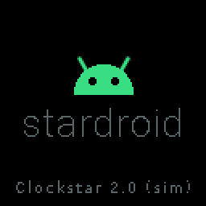
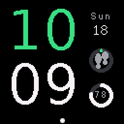
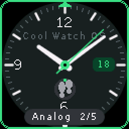
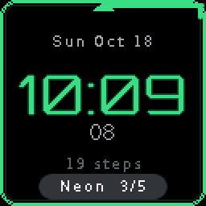
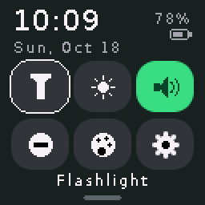
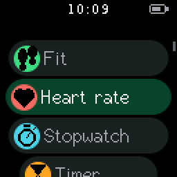
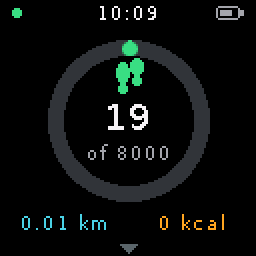
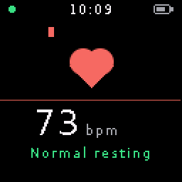
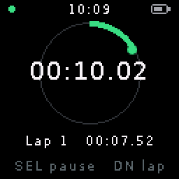
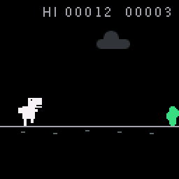
</p>

## Features

- **Boot animation** with bouncing dots and a light sweep across the wordmark.
- **First-boot setup wizard**: welcome, time, date, 12/24 h, accent colour,
  watch face, daily step goal, and a tour of the buttons.
- **5 watch faces**: Pixel, Analog (smooth sweeping second hand), Neon
  (seconds trace the screen edge), Rings, and Terminal (`adb shell` style).
  Hold SELECT on the face to change it.
- **Material You-style accent colours**: Android green, Ocean, Lavender,
  Coral, Sunny, Bubblegum.
- **System UI**: status bar, quick-settings tiles (flashlight, brightness,
  sound, Do Not Disturb, theme, settings), notification list, heads-up
  notifications, toasts, power menu (hold BACK), screen timeout, and a
  notification LED that blinks while something is unread (red while charging,
  green when full).
- **Fit**: daily steps from the IMU's hardware pedometer (it keeps counting
  while the watch sleeps), distance, calories, goal ring, and a 7-day chart.
- **Heart rate**: see the note below.
- **Clock**: stopwatch with laps, countdown timer, and a daily alarm with
  snooze. Timers and alarms wake the watch from sleep.
- **Tools**: calendar, bubble level, and a flashlight with white, red and warm
  modes.
- **Games**: Snake and Dino run.
- **Settings**: brightness, screen timeout, watch face, colour, sound, DND,
  24-hour time, time and date, step goal, battery, About watch, and reset.
  Tap *Build number* 7 times to unlock developer options.
- **Diagnostics** (Settings → Diagnostics): a guided hardware self-test, see
  [Testing](#testing).

### About heart rate

The Clockstar 2.0 has **no heart-rate sensor** (no optical PPG). Instead of
showing made-up numbers, the Heart rate app measures your pulse the manual
way: feel your pulse on your wrist or neck and tap SELECT with each beat. It
works out your BPM, shows a zone (low, normal resting, elevated) and keeps
your last 5 readings. It is not a medical device.

## Buttons

| Button | On the watch face | In apps |
| --- | --- | --- |
| UP | Quick settings | Move up / previous |
| DOWN | Notifications | Move down / next |
| SELECT | App drawer (hold: change face) | Select / confirm |
| BACK | Turn the screen off | Back (hold: power menu) |

## Quick start: `./stardroid.sh`

One script does the whole job, and installs whatever is missing:

```sh
./stardroid.sh            # install tools if needed, run the tests, build dist/stardroid-clockstar.bin
./stardroid.sh flash      # build and flash the watch over USB (finds the port itself)
./stardroid.sh deploy     # test, flash, then open the serial monitor
./stardroid.sh sim        # run the desktop simulator
./stardroid.sh test timer # run only the tests with "timer" in the name
./stardroid.sh help       # every command
```

For a Watchy, add `--watch watchy` (or `watchy-v15` / `watchy-v10`) in front
of any command, for example `./stardroid.sh --watch watchy flash`.

It works on Linux (apt, dnf or pacman) and macOS (Homebrew). The rest of
this README shows the same steps run by hand.

## Building and flashing

You need [PlatformIO](https://platformio.org/install/cli).

```sh
pio run                 # build (Clockstar)
pio run -t upload       # flash over USB-C
pio device monitor      # serial log
pio run -e watchy -t upload   # Watchy v2.0 (watchy-v15, watchy-v10 for older boards)
```

The ESP32-S3 flashes over its built-in USB, so no driver or button dance
should be needed. Every CI run also attaches a
merged `stardroid-clockstar.bin` that you can flash at offset `0x0` with
esptool or the [ESP web flasher](https://espressif.github.io/esptool-js/).

**To go back to the stock firmware**, flash the image from the
[CircuitMess Artemis firmware releases](https://github.com/CircuitMess/GC_Artemis-Firmware/releases).

## Watchy

<p>
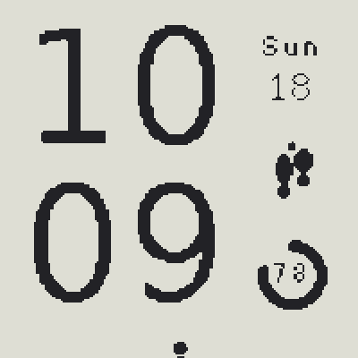
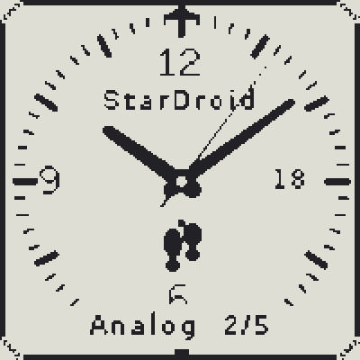
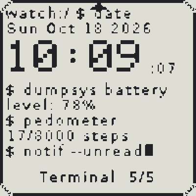
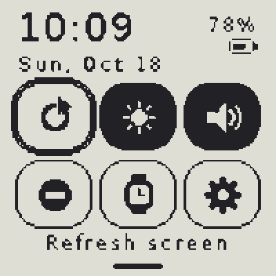
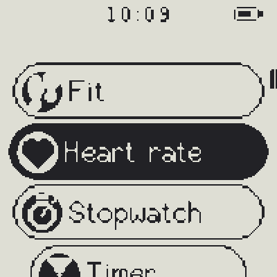
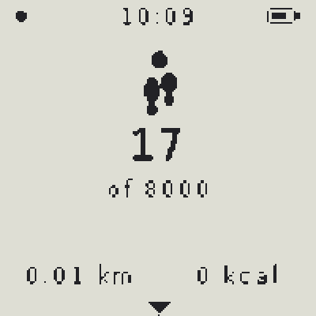
</p>

The same OS runs on the [SQFMI Watchy](https://watchy.sqfmi.com/) kit
(ESP32-PICO-D4, 1.54" 200×200 e-paper, BMA423 accelerometer, vibration motor).
It supports the v1.0, v1.5 and v2.0 boards; the revision is printed on the
PCB. The newer ESP32-S3 Watchy v3 isn't supported yet.

**Flashing:** `./stardroid.sh --watch watchy flash` (v2.0), or
`--watch watchy-v15` / `--watch watchy-v10`. These revisions differ in the UP
button pin, the battery pin and the clock chip (DS3231 on v1.0, PCF8563
later). The clock chip is detected automatically, but the pins come from the
build, so pick the right one. Watchy connects through a CP2104 USB-serial
chip, which may need the Silicon Labs driver on Windows and macOS.

**Buttons:** MENU (bottom left) is SELECT, BACK (top left) is BACK, and the
two right-hand buttons are UP and DOWN.

**What's different on e-paper:**

- **Rendering:** the OS draws its usual 128×128 frame. A converter scales it
  smoothly to 200×200 and turns it into crisp black and white, and the panel
  only refreshes when the picture actually changes. Animations are off, and
  clocks tick in whole seconds.
- **Ambient mode:** when the screen times out, the watch face stays visible
  without its seconds. The CPU sleeps and wakes once a minute to update it,
  and any button wakes it straight away.
- **Paper mode** (on by default) gives black ink on white, like a printed
  page. Turn it off in quick settings or Settings for white on black.
- **Refresh screen** in quick settings does a full refresh to clear
  e-paper ghosting. One also runs automatically every 30 ambient updates.
- **No backlight, buzzer or LEDs:** sounds become vibrations, so the
  quick-settings tiles and Settings change to match. The Flashlight and the
  fast-paced Dino game are hidden; Snake runs slower. The colour picker is
  skipped, and Diagnostics tests vibration instead of the buzzer and skips the
  backlight and LED stages.
- **Heart rate** keeps its screen still while you tap. An e-paper refresh
  would otherwise delay button presses and skew the timing.
- **Lost presses:** presses made during a refresh (about half a second) are
  remembered and replayed, so they aren't lost.

**Battery life:** the stock Watchy firmware deep-sleeps between minutes.
StarDroid uses light sleep so timers, alarms and app state survive. Expect
fewer days per charge than stock. It hasn't been measured on hardware yet.

**To go back to the stock firmware**, flash one of the examples from the
[Watchy library](https://github.com/sqfmi/Watchy) with the Arduino IDE.

The Watchy drivers follow the official [Watchy library](https://github.com/sqfmi/Watchy)
for pins, and use [GxEPD2](https://github.com/ZinggJM/GxEPD2) for the panel
and [SensorLib](https://github.com/lewisxhe/SensorLib) for the BMA423 step
counter.

## Desktop simulator

The same OS and app code runs on your computer on top of LovyanGFX's SDL2
backend, so you can work on the UI without flashing.

```sh
sudo apt install libsdl2-dev        # or: brew install sdl2
cmake -S sim -B build/sim && cmake --build build/sim -j
./build/sim/stardroid-sim
```

Keys: arrows for Up and Down, Enter or Right for Select, Esc or Left for Back.
Add `--watchy` to simulate the Watchy's e-paper screen.

The simulator also has a headless, scripted mode. It is used to render
`docs/screenshots` (`sim/screenshots.sh build/sim/stardroid-sim`) and as a
smoke test in CI:

```sh
./build/sim/stardroid-sim --out shots --script "w3300 s s p:setup"
```

## Testing

### Test program (on your computer and in CI)

`tests/os_tests.cpp` runs the real OS and apps on the headless simulator with
a virtual clock and scripted button presses. It currently has 56 tests,
covering:

- Date and time maths, and setting the clock
- The time and number pickers and lists
- Input: click, long press, auto-repeat and debouncing
- The activity lifecycle, back stack, a quick double-Back, and going home
- The setup wizard end to end, including the values it saves
- Every watch-face button, opening every app in the drawer, and feeding
  input to every app
- 1,500 random button presses (a fuzz test)
- Notifications: the cap of 8, newest first, unread state, and Do Not Disturb
- Quick settings and the power menu
- Screen timeout, waking (the wake press is swallowed), and returning to the
  watch face
- A timer and an alarm firing while the watch sleeps, snooze, and no double
  ringing
- Step counting, midnight rollover, pedometer resets and the 7-day history
- Heart-rate BPM from taps
- Saving and loading settings, and the developer easter egg
- Diagnostics, including a missing sensor
- On Watchy: refreshing only on change, ambient updates once a minute, the
  hidden apps, paper mode, the refresh tile, setup without the colour step,
  a still heart-rate screen, Diagnostics skipping missing hardware, and
  input and fuzz tests on every app

Each test runs in its own process, so one crash fails only that test, and
the whole suite takes about a second.

```sh
cmake -S sim -B build/sim && cmake --build build/sim -j
./build/sim/stardroid-tests            # everything
./build/sim/stardroid-tests timer      # tests with "timer" in the name
ctest --test-dir build/sim             # same, via CTest
```

### Diagnostics (on the watch)

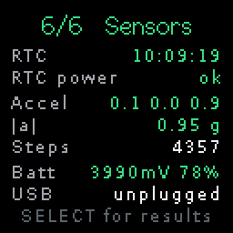 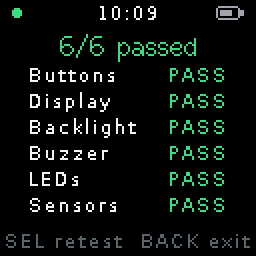

Settings → Diagnostics walks through 6 stages and ends with a pass/fail
summary:

1. **Buttons**: press all four (20 s limit).
2. **Display**: full-screen red, green, blue, white, black, then gradients
   and a 1 px border to catch dead pixels or a wrong screen offset.
3. **Backlight**: brightness fades up and down.
4. **Buzzer**: a rising tone.
5. **LEDs**: the RGB LED cycles red, green, blue, then each small LED lights
   in turn.
6. **Sensors** (scored automatically): the RTC is running and kept its time,
   the accelerometer reads about 1 g at rest, and the battery voltage is
   plausible. It also shows the pedometer count and USB/charging state.

For stages 2 to 5, press SELECT if it looked or sounded right and DOWN if not.
Hold SELECT to quit at any time.

## How it works

```
src/
  hal/       Hardware layer: Clockstar 2.0 (pins, display, RTC, IMU, battery,
             backlight, buzzer, light sleep), Watchy (e-paper, RTC, BMA423,
             vibration), the e-paper converter and the SDL simulator
  os/        The framework: activity manager and back stack, input
             (click / long-press / repeat), power management, notifications,
             system UI, settings, widgets and icons
  apps/      Watch faces and apps
sim/         Desktop simulator
```

- **Activities**: each app subclasses `os::Activity` (`onCreate`, `onResume`,
  `onPause`, `onDestroy`, `onUpdate`, `onDraw`, `onKey`) and is registered with
  an `os::AppInfo`. `os::startActivity({"timer"})` pushes it with a Material
  slide transition, and BACK pops it.
- **Services**: `os::Service` covers background work such as timers and
  alarms. While the screen is off the ESP32-S3 sits in light sleep and wakes
  on any button, or when the next service deadline comes up.
- **Rendering**: everything draws into a 128×128 RGB565 sprite, which is
  pushed to the ST7735S over 40 MHz SPI at up to 40 fps. On Watchy,
  `hal/Mono.cpp` converts it to 200×200 black and white for the e-paper.
- **Hardware features**: `hal::features()` describes the watch (colour,
  e-paper, backlight, buzzer, LEDs). Apps declare what they need
  (`os::NeedsBacklight`, `os::NeedsFastDisplay`), and widgets switch to
  outlines and inverted focus when `ui::mono()` is true.

### Hardware notes

Pin maps, display offsets, the BM8563 RTC, the LSM6DS3TR-C IMU and the
battery-sense calibration come from CircuitMess's open-source
[Artemis firmware](https://github.com/CircuitMess/GC_Artemis-Firmware). The
board revision is read from eFuse, so revisions 1 to 3 all get the right pins
and display offsets.

## License

GPL-3.0, see [LICENSE](LICENSE).
